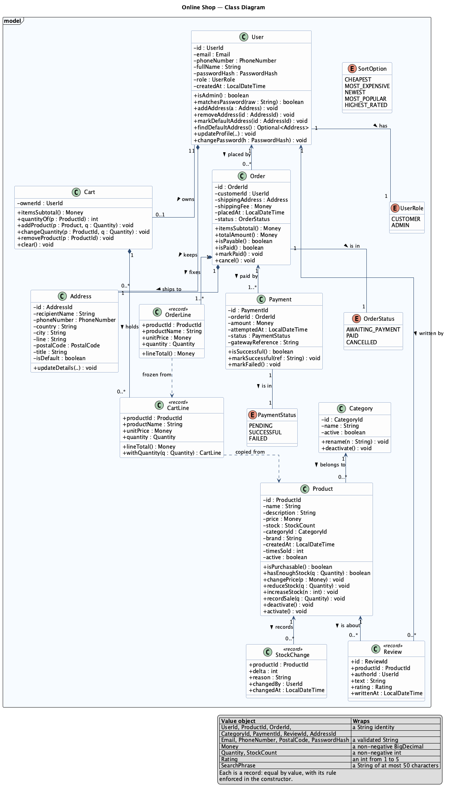
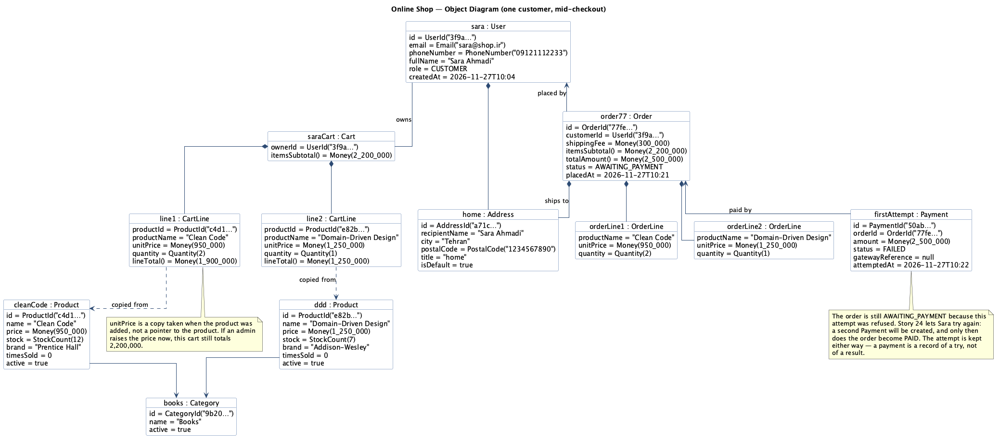
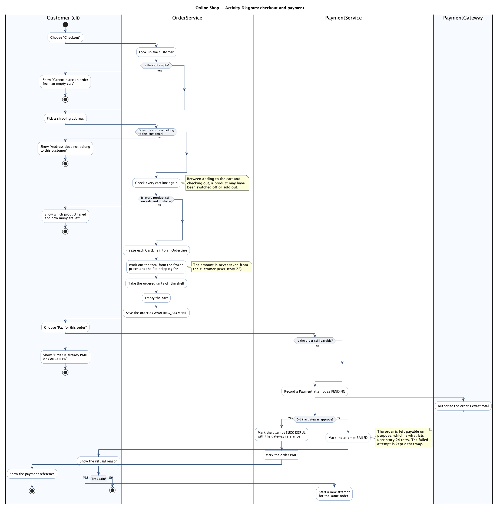
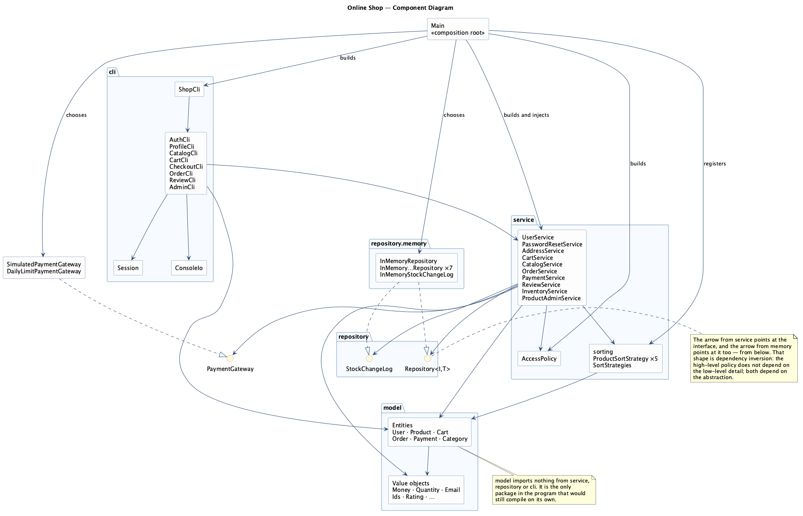
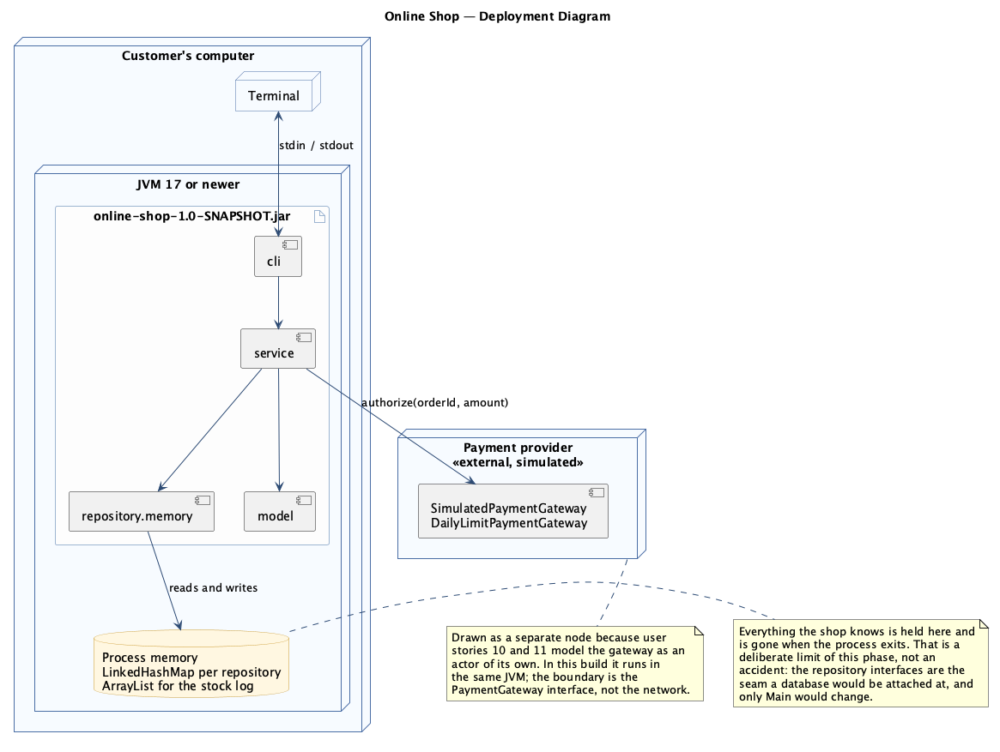
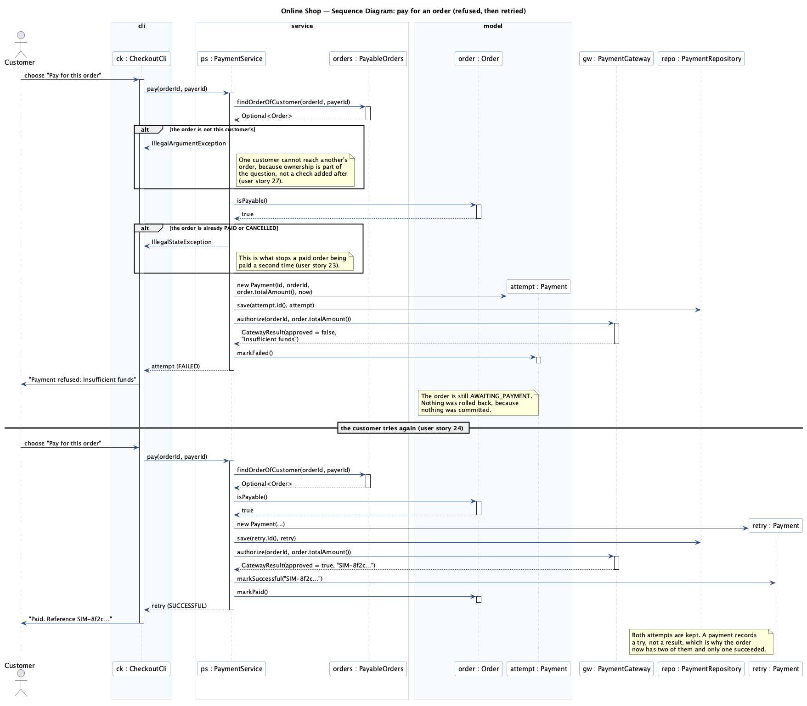
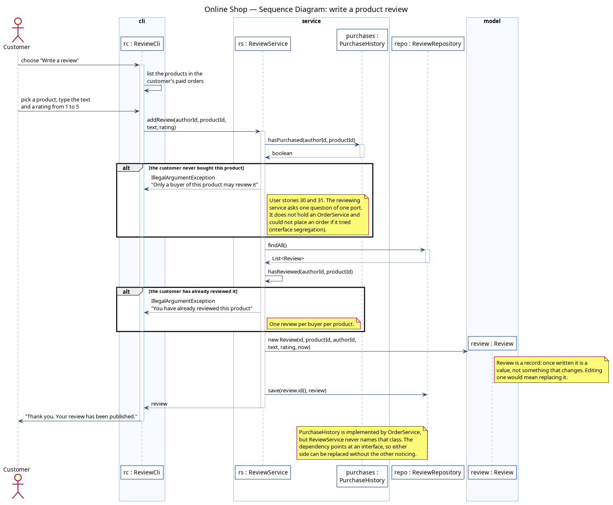

# مستند طراحی — فاز ۲

**درس:** اصول طراحی نرم‌افزار · **استاد:** دکتر هانیه فلاح · **سرتدریسیار:** امیر محمد ذاکر
**دانشکدهٔ ریاضی و علوم کامپیوتر، دانشگاه صنعتی امیرکبیر** · پاییز ۱۴۰۵

---

## اعضای گروه

| | نام و نام خانوادگی | شمارهٔ دانشجویی | گیت‌هاب |
|---|---|---|---|
| عضو اول | ‹نام عضو اول› | ‹شماره› | `RohamAbootorabian` |
| عضو دوم | ‹نام عضو دوم› | ‹شماره› | ‹یوزرنیم› |

**مخزن پروژه:** `https://github.com/RohamAbootorabian/aut-online-shop`

### تقسیم وظایف

| عضو | کار |
|---|---|
| عضو اول (`member-1`) | بازطراحی SOLID — هر پنج اصل · پنج نمودار اصلی و نمودار توالی پرداخت · تست‌های تازه · README و مستند طراحی |
| عضو دوم (`member-2`) | نمودار توالی نوشتن نظر · **Code Review** روی ادغام `member-1` در `develop` |

هر دو عضو شاخهٔ شخصی خود را دارند و تغییرات هر کدام از مسیر
`feature → شاخهٔ شخصی → develop → main` رفته است.

---

## ۱. معرفی کوتاه سیستم

یک فروشگاه اینترنتی خط فرمانی در جاوا ۱۷. مشتری حساب باز می‌کند، فهرست محصولات را
می‌بیند و جست‌وجو و فیلتر و مرتب‌سازی می‌کند، سبد می‌بندد، سفارش ثبت می‌کند، پرداخت می‌کند
و نظر می‌گذارد. مدیر محصول و دسته‌بندی و موجودی را اداره می‌کند.

ورودی طراحی، ۳۶ داستان کاربری فاز اول است که به ۱۵ Domain Story و ۱۰۹ فعالیت تبدیل شده
بودند.

### لایه‌ها

```
Main  →  cli  →  service  →  repository (رابط)  →  model
                      ↑
            repository.memory (پیاده‌سازی)
```

| لایه | مسئولیت | وابستگی |
|---|---|---|
| `model` | Entity، Value Object، قوانین دامنه | **به هیچ‌چیز** |
| `repository` | رابط‌های ذخیره‌سازی | فقط `model` |
| `repository.memory` | ذخیره‌سازی درون‌حافظه | `model` و رابط‌های `repository` |
| `service` | هماهنگی سناریوها | `model` و **رابط‌های** `repository` |
| `cli` | گرفتن ورودی، نمایش خروجی | `service` و `model` |
| `Main` | انتخاب پیاده‌سازی‌ها و سیم‌کشی | به همه |

### سه تصمیم که کل طراحی را شکل داده‌اند

- **قیمت در لحظهٔ افزودن به سبد قفل می‌شود.** `CartLine` یک کپی از قیمت نگه می‌دارد، نه یک
  اشاره به محصول.
- **پرداخت یک «تلاش» است، نه یک «نتیجه».** پرداخت ناموفق سفارش را قابل‌پرداخت نگه می‌دارد
  و خودش هم حذف نمی‌شود (داستان ۲۴).
- **غیرفعال کردن محصول، گذشته را خراب نمی‌کند** (داستان ۳۵).

---

## ۲. نمودار کلاس



منبع: [`diagrams/01-class-diagram.puml`](diagrams/01-class-diagram.puml)

این نمودار از کد **بعد از** بازطراحی SOLID کشیده شده است. دو انتخاب که ارزش توضیح دارند:

**دوازده Value Object تک‌فیلدی در legend آمده‌اند، نه در دوازده جعبه.** `UserId`،
`ProductId`، `Money`، `Quantity` و بقیه، record هایی هستند که یک مقدار را با قانونش
می‌پیچند و رابطهٔ مستقلی ندارند. کشیدنشان ساختار اصلی را دفن می‌کرد.

**تعدّدها قوانین کسب‌وکار را رمزگذاری می‌کنند، نه فقط ساختار داده را:**

| رابطه | تعدّد | چرا |
|---|---|---|
| `Cart` ← `CartLine` | `0..*` | سبد خالی مجاز است |
| `Order` ← `OrderLine` | `1..*` | سفارش بدون قلم معنا ندارد |
| `Order` ← `Payment` | `1..*` | هر تلاش پرداخت یک رکورد است؛ پس می‌تواند چند تا باشد |
| `User` ← `Cart` | `0..1` | سبد تا اولین افزودن ساخته نمی‌شود |

**`Review` داخل `Product` نیست.** نظر چرخهٔ عمر خودش را دارد و نویسنده‌اش `User` است؛
قرار دادنش درون Aggregate محصول، نوشتن نظر را به بارگذاری کل محصول گره می‌زد.

---

## ۳. نمودار شیء



منبع: [`diagrams/02-object-diagram.puml`](diagrams/02-object-diagram.puml)

یک لحظهٔ واقعی از برنامهٔ در حال اجرا: مشتری با سبدِ دو قلمی، سفارشِ ثبت‌شده، و اولین
تلاش پرداخت که رد شده است. مقادیر همان‌هایی‌اند که `Main.seedShop` می‌سازد، پس این
وضعیت با اجرای برنامه قابل بازتولید است.

دو نکته‌ای که این نمودار نشان می‌دهد و نمودار کلاس نمی‌توانست:

- `line1.unitPrice` برابر `Money(950_000)` است — یک **کپی**، نه اشاره به `cleanCode`. اگر
  مدیر همین حالا قیمت را عوض کند، جمع سبد هنوز ۲٬۲۰۰٬۰۰۰ است.
- `order77.status` هنوز `AWAITING_PAYMENT` است با آنکه یک `Payment` با وضعیت `FAILED`
  به آن وصل است. دقیقاً همان چیزی که داستان ۲۴ می‌خواهد.

---

## ۴. نمودار فعالیت



منبع: [`diagrams/03-activity-diagram.puml`](diagrams/03-activity-diagram.puml)

مسیر ثبت سفارش تا پرداخت. **هر تصمیم در این نمودار یک شاخهٔ واقعی در
`OrderService.startCheckout` یا `PaymentService.pay` است** — هیچ‌کدام برای زیباتر شدن
نمودار اضافه نشده‌اند:

| تصمیم در نمودار | کجای کد |
|---|---|
| سبد خالی است؟ | `startCheckout` — `cart.isEmpty()` |
| آدرس مال همین مشتری است؟ | `startCheckout` — `customer.findAddress(...)` |
| همهٔ محصول‌ها هنوز موجودند؟ | `requireEveryLineStillAvailable` |
| سفارش هنوز قابل پرداخت است؟ | `pay` — `order.isPayable()` |
| درگاه تأیید کرد؟ | `pay` — `result.approved()` |

نکتهٔ طراحی‌ای که نمودار برجسته می‌کند: بین افزودن به سبد و ثبت سفارش، ممکن است محصول
غیرفعال یا تمام شده باشد. برای همین موجودی **دو بار** چک می‌شود — یک بار موقع افزودن به
سبد و یک بار موقع ثبت سفارش.

---

## ۵. نمودار کامپوننت



منبع: [`diagrams/04-component-diagram.puml`](diagrams/04-component-diagram.puml)

هر پیکان در این نمودار یک `import` واقعی در کد است، و **هر پیکانی که نیست، یک وابستگی
است که کد ندارد.** این را می‌شود بررسی کرد؛ هر پنج دستور زیر باید هیچ چیزی برنگردانند:

```sh
grep -rl 'import ir.aut.shop.\(service\|cli\|repository\)' src/main/java/ir/aut/shop/model/
grep -rl 'import ir.aut.shop.cli'                          src/main/java/ir/aut/shop/service/
grep -rl 'repository.memory'                               src/main/java/ir/aut/shop/service/
grep -rn 'public [A-Z][A-Za-z]*Service(.*Map<'             src/main/java/
grep -rl 'System.out' src/main/java/ir/aut/shop --exclude-dir=cli
```

شکل مهم نمودار این است: پیکان از `service` به رابط `Repository` می‌رود، و پیکان از
`repository.memory` هم به همان رابط می‌رود — **از پایین**. سیاست سطح‌بالا به جزئیات
سطح‌پایین وابسته نیست؛ هر دو به انتزاع وابسته‌اند. این تعریف وارونگی وابستگی است.

---

## ۶. نمودار استقرار



منبع: [`diagrams/05-deployment-diagram.puml`](diagrams/05-deployment-diagram.puml)

این نمودار عمداً ساده است، چون سیستم واقعاً ساده است: یک ماشین، یک JVM، یک jar، و
وضعیتی که با پایان یافتن پروسه از بین می‌رود.

دو چیزی که نمودار صادقانه می‌گوید:

- **داده پایدار نیست.** همه چیز در `LinkedHashMap` و `ArrayList` داخل حافظهٔ پروسه است.
  این محدودیت آگاهانهٔ این فاز است، نه یک غفلت — و نمودار نشان می‌دهد دیتابیس دقیقاً کجا
  وصل می‌شود: پشت رابط‌های `repository`، جایی که فقط `Main` عوض می‌شود.
- **درگاه پرداخت گرهٔ جداست** چون داستان‌های ۱۰ و ۱۱ آن را Actor مستقل می‌دانند — هرچند
  در این build داخل همان JVM اجرا می‌شود. مرز، رابط `PaymentGateway` است نه شبکه.

---

## ۷. نمودار توالی (بخش امتیازی)



منبع: [`diagrams/06-sequence-diagram.puml`](diagrams/06-sequence-diagram.puml)

سناریوی انتخاب‌شده: **پرداخت سفارش، با یک رد شدن و بعد تلاش دوبارهٔ موفق** — داستان‌های
۲۳، ۲۴ و ۲۷ در یک نمودار.

چرا این سناریو؟ چون تنها جایی است که هر پنج بازیگر معماری در یک مسیر کنار هم می‌آیند:
یک صفحهٔ `cli`، یک سرویس، یک **پورت** (`PayableOrders`)، دو Entity، و یک آداپتور بیرونی
(`PaymentGateway`). توالی پیام‌ها در آن مو به مو همان چیزی است که `PaymentService.pay`
انجام می‌دهد.

### نمودار توالی دوم — نوشتن نظر



منبع: [`diagrams/07-sequence-review.puml`](diagrams/07-sequence-review.puml)

داستان‌های ۳۰ تا ۳۲: مشتری برای محصولی که خریده نظر می‌نویسد. این نمودار روشن‌ترین
تصویر از **تفکیک رابط** در کل کد است — `ReviewService` دقیقاً یک حقیقت از سمت سفارش‌ها
لازم دارد («این شخص این محصول را خریده؟») و آن را از پورت `PurchaseHistory` می‌پرسد، نه
از `OrderService`. در نمودار فقط همان یک پیکان از آن مرز رد می‌شود.

هر دو رد شدن هم کشیده شده‌اند: کسی که نخریده (داستان ۳۰) و کسی که قبلاً نظر داده
(داستان ۳۱).

---

## ۸. بازطراحی بر اساس اصول SOLID

پنج اصل، پنج Pull Request، و در هر کدام یک نقض واقعی که در کد وجود داشت.

| PR | اصل | نقض | تعداد تست بعد از اصلاح |
|---|---|---|---|
| [#1](https://github.com/RohamAbootorabian/aut-online-shop/pull/1) | DIP | نُه سرویس به `java.util.Map` چسبیده بودند | ۴۰ |
| [#2](https://github.com/RohamAbootorabian/aut-online-shop/pull/2) | DIP + ISP | سرویس‌ها به **کلاسِ** هم وابسته بودند | ۴۰ |
| [#3](https://github.com/RohamAbootorabian/aut-online-shop/pull/3) | OCP | مرتب‌سازی یک `switch` بسته بود | ۴۶ |
| [#4](https://github.com/RohamAbootorabian/aut-online-shop/pull/4) | SRP | `requireAdmin` سه بار نوشته شده بود؛ `UserService` سه کار می‌کرد | ۵۲ |
| [#5](https://github.com/RohamAbootorabian/aut-online-shop/pull/5) | LSP | قرارداد `PaymentGateway` نانوشته بود | ۶۵ |

---

### ۸٫۱ Single Responsibility — یک کلاس، یک دلیل برای تغییر

#### نقض اول: یک قانون، سه بار نوشته

`ProductAdminService`، `OrderService` و `InventoryService` هر کدام یک متد خصوصی
`requireAdmin(User)` داشتند. همان قانون، سه کپی، با سه پیام خطای متفاوت که می‌توانستند از
هم دور بیفتند.

ولی مشکل بزرگ‌تر از تکرار بود: **تصمیم‌گیری دربارهٔ اینکه چه کسی مجاز است، جزئی از مدیریت
موجودی نیست.** کلاسی که دو دلیل برای تغییر دارد، یکی بیش از حد دارد.

```java
// پیش از اصلاح — در هر سه سرویس
private static void requireAdmin(User actor) {
    if (actor == null || !actor.isAdmin()) {
        throw new IllegalArgumentException("Only an admin may manage stock");
    }
}
```

**اصلاح:** کلاس `AccessPolicy`. قانون در یک جا زندگی می‌کند و به سه سرویس تزریق می‌شود.

```java
// پس از اصلاح — در AccessPolicy، یک بار
public void requireAdmin(User actor, String action) {
    if (actor == null || !actor.isAdmin()) {
        throw new IllegalArgumentException("Only an admin may " + action);
    }
}
```

چون کار مورد نظر پارامتر شد، یک پیام به هر ده فراخوانی خدمت می‌کند.

#### نقض دوم: `UserService` سه کار می‌کرد

باز کردن حساب، ورود، **و** صدور و مصرف توکن بازیابی رمز — حتی یک
`Map<String, UserId>` خصوصی برای توکن‌ها داشت.

دادن تاریخ انقضا به توکن، یا فرستادنش با ایمیل به‌جای چاپ کردن، هیچ ربطی به نحوهٔ باز
شدن حساب ندارد — ولی کلاس حساب را باز می‌کرد.

**اصلاح:** کلاس `PasswordResetService`. `UserService` حساب و ورود را نگه می‌دارد و دو در
باریک باز می‌کند: `findByEmail` و `changePassword`.

> **نکتهٔ طراحی:** توکن‌ها در `PasswordResetService` نگه داشته می‌شوند و نه در repository
> حساب‌ها — چون توکن بازیابی **جزئی از حساب نیست**، یک یادداشت کوتاه‌عمر دربارهٔ آن است.

---

### ۸٫۲ Open–Closed — باز برای توسعه، بسته برای تغییر

#### نقض

`CatalogService.comparatorFor(SortOption)` یک `switch` روی هر پنج ترتیب بود:

```java
// پیش از اصلاح
private Comparator<Product> comparatorFor(SortOption option) {
    return switch (option) {
        case CHEAPEST -> Comparator.comparing(product -> product.price().amount());
        case MOST_EXPENSIVE -> ...
        case NEWEST -> ...
        case MOST_POPULAR -> ...
        case HIGHEST_RATED -> ...
    };
}
```

ششمین ترتیبی که فروشگاه بخواهد، فقط با باز کردن یک کلاسِ تمام‌شده و تست‌شده به دست
می‌آمد. یعنی کلاس **بسته برای توسعه و باز برای تغییر** بود — دقیقاً برعکس چیزی که باید.

#### اصلاح

```java
// پس از اصلاح
@FunctionalInterface
public interface ProductSortStrategy {
    Comparator<Product> comparator(ProductRatings ratings);
}
```

یک کلاس کوچک برای هر ترتیب (`CheapestFirst`، `NewestFirst`، `HighestRatedFirst`، …)، و یک
رجیستری `SortStrategies` که از بیرون پر می‌شود. `CatalogService` دیگر نمی‌داند چند ترتیب
وجود دارد:

```java
return productsToSort.stream()
        .sorted(sortStrategies.strategyFor(option).comparator(ratings))
        .toList();
```

`HighestRatedFirst` امتیازها را **پارامتر** می‌گیرد و نگه نمی‌دارد، تا چهار استراتژی
دیگر مجبور نشوند وابستگی‌ای را حمل کنند که کاری با آن ندارند.

#### یادداشت صادقانه

`SortOption` هنوز enum است، چون داستان ۱۲ منوی قابل‌انتخاب را دقیقاً پنج گزینه تثبیت کرده
و enum همان چیزی است که نمی‌گذارد گزینهٔ ناشناخته‌ای برسد. **آنچه حالا باز برای توسعه است
رفتار مرتب‌سازی است:** هیچ کلاس موجودی با افزودن ترتیب تازه شاخهٔ جدید نمی‌گیرد.

تست آخر `SortStrategiesTest` همین را ثابت می‌کند: یک ترتیب ششم که فروشگاه هرگز نداشته را
ثبت می‌کند و با آن مرتب می‌کند، **بدون دست زدن به هیچ کلاسی که از قبل کار می‌کرد.**

---

### ۸٫۳ Liskov Substitution — جانشینی که واقعاً جانشین است

#### نقض

`PaymentGateway` یک رابط بود با یک پیاده‌سازی و **هیچ قرارداد نوشته‌شده‌ای**. هیچ‌چیز
نمی‌گفت یک جایگزین مجاز به چه کاری هست و چه کاری نیست.

پس «هر درگاهی را می‌شود جایگزین کرد» ادعایی بود که هیچ پشتوانه‌ای نداشت — و اولین
پیاده‌سازی‌ای که برای مبلغ بزرگ `throw` می‌کرد، هر فراخواننده را می‌شکست بی‌آنکه کامپایلر
متوجه شود.

#### اصلاح: سه قدم

**۱. قرارداد نوشته شد** — شش قاعده روی خود رابط. مهم‌ترینشان:

> **رد کردن یک جواب است، نه یک خطا.** درگاهی که پول را نمی‌گیرد، یک `GatewayResult` رد
> کننده با دلیلش برمی‌گرداند. `throw` نمی‌کند.

**۲. یک پیاده‌سازی دوم اضافه شد** — `DailyLimitPaymentGateway` که بالای یک سقف را رد
می‌کند:

```java
if (amount.amount().compareTo(ceiling.amount()) > 0) {
    return GatewayResult.refused(
            "This card will not take more than " + ceiling + " in one payment");
}
```

به این دقت کنید که چه **نمی‌کند**: `throw` نمی‌کند. `throw` کردن یعنی یک Precondition
قوی‌تر از آنچه رابط اعلام کرده — فراخواننده مجبور می‌شد خطای تازه‌ای را یاد بگیرد که رابط
هرگز از آن خبر نداده بود، و دو درگاه دیگر جایگزین‌پذیر نبودند.

**۳. یک تست قرارداد، روی هر دو.** `PaymentGatewayContractTest` انتزاعی است و شش قاعده را
نگه می‌دارد؛ هر پیاده‌سازی یک زیرکلاس با دو متد اضافه می‌کند:

```java
class DailyLimitPaymentGatewayContractTest extends PaymentGatewayContractTest {
    @Override protected PaymentGateway gateway()    { return subject; }
    @Override protected Money acceptableAmount()    { return Money.of("950000"); }
}
```

جانشین‌پذیری را کامپایلر نمی‌تواند بررسی کند. نوشتن قاعده‌ها یک بار و ارث بردنشان، همان
چیزی است که آن را از یک **وعده** به چیزی تبدیل می‌کند که **build را می‌شکند**.

---

### ۸٫۴ Interface Segregation — هیچ‌کس به چیزی که لازم ندارد وابسته نشود

#### نقض

چهار سرویس یک فیلد از سرویسِ **مشخص** دیگری داشتند و یکی دو متدش را صدا می‌زدند:

| مصرف‌کننده | چه چیزی نگه می‌داشت | واقعاً چه استفاده می‌کرد |
|---|---|---|
| `CatalogService` | `ReviewService` | `averageRating` |
| `OrderService` | `CartService` | `cartOf`، `clearCart` |
| `ReviewService` | `OrderService` | `hasPurchased` |
| `PaymentService` | `OrderService` | `findOrderOfCustomer` |

هر کدام در برابر حدود ده متدی کامپایل می‌شد که هیچ کاری با آن‌ها نداشت.

#### اصلاح

چهار پورت، هر کدام دقیقاً به اندازهٔ نیاز مصرف‌کننده‌اش:

```java
@FunctionalInterface
public interface PurchaseHistory {
    boolean hasPurchased(UserId customerId, ProductId productId);
}
```

داستان‌های ۳۰ و ۳۱ می‌گویند فقط خریدار می‌تواند نظر بدهد — پس نوشتن نظر دقیقاً **یک**
سؤال از سرویس سفارش دارد. ثبت سفارش، لغو، فهرست مدیریتی: هیچ‌کدام کار نظر دادن نیست، و
این رابط شکلِ همین جمله است.

**و یک نمونهٔ دیگر از همان اصل:** `StockChangeLog` عمداً از `Repository` ارث نمی‌برد. یک
تغییر موجودی هرگز با هویتش جست‌وجو نمی‌شود، جایگزین نمی‌شود و حذف نمی‌شود؛ لاگ فقط رشد
می‌کند. دادن `save` و `contains` به سرویس موجودی، رابط را از آنچه فراخواننده **مجاز** است
فراتر می‌برد.

```java
public interface StockChangeLog {
    void append(StockChange change);
    List<StockChange> findAll();
}
```

---

### ۸٫۵ Dependency Inversion — وابستگی به انتزاع، نه به جزئیات

این بزرگ‌ترین بازطراحی این فاز بود.

#### نقض

نُه سرویس در سازندهٔ خود `java.util.Map` می‌گرفتند:

```java
// پیش از اصلاح
public UserService(Map<UserId, User> users) { ... }
public CartService(Map<UserId, Cart> carts, Map<ProductId, Product> products) { ... }
public OrderService(Map<OrderId, Order> orders, Map<UserId, User> users,
        Map<ProductId, Product> products, CartService cartService) { ... }
```

یعنی **هر نُه سرویس به یک تصمیم ذخیره‌سازی میخکوب شده بودند.** رفتن به سمت دیتابیس، هر
نُه تا را دست می‌زد.

#### اصلاح

```java
public interface Repository<I, T> {
    void save(I id, T item);
    Optional<T> findById(I id);
    List<T> findAll();
    boolean contains(I id);
}
```

هفت رابط `…Repository` (ارث‌بر از این)، به‌علاوهٔ `StockChangeLog`، در پکیج
`ir.aut.shop.repository`. پیاده‌سازی‌های درون‌حافظه در `ir.aut.shop.repository.memory`.

```java
// پس از اصلاح
public UserService(UserRepository users) { ... }
public OrderService(OrderRepository orders, UserRepository users,
        ProductRepository products, CheckoutBasket basket, AccessPolicy access) { ... }
```

حالا **`Main` تنها کلاس برنامه است که نام یک تکنولوژی ذخیره‌سازی را می‌داند:**

```java
UserRepository users = new InMemoryUserRepository();
CategoryRepository categories = new InMemoryCategoryRepository();
ProductRepository products = new InMemoryProductRepository();
CartRepository carts = new InMemoryCartRepository();
OrderRepository orders = new InMemoryOrderRepository();
PaymentRepository payments = new InMemoryPaymentRepository();
ReviewRepository reviews = new InMemoryReviewRepository();
StockChangeLog stockChangeLog = new InMemoryStockChangeLog();
```

رفتن روی دیتابیس، تغییر همین هشت خط است و نه جای دیگری.

**و در همان PR، یک تست قرارداد برای خود repository:** `RepositoryContractTest` می‌گوید هر
پیاده‌سازی چه باید بکند — از جمله اینکه `findAll()` باید کپی بدهد نه ارجاع داخلی، تا
نمایش داخلی لو نرود.

---

## ۹. اثبات

### تست‌ها

```sh
mvn test
```

```
Tests run: 65, Failures: 0, Errors: 0, Skipped: 0
BUILD SUCCESS
```

| کلاس تست | تعداد | چه چیزی را ثابت می‌کند |
|---|---|---|
| `ValueObjectRulesTest` | ۱۰ | قوانین دامنه در نوع‌ها واقعاً اجرا می‌شوند |
| `CartTest` | ۹ | سبد قراردادش را رعایت می‌کند |
| `ShopScenarioTest` | ۱۵ | کل مسیر خرید از ابتدا تا پرداخت |
| `RepositoryContractTest` | ۶ | هر پیاده‌سازی repository قراردادش را نگه می‌دارد |
| `SortStrategiesTest` | ۶ | مرتب‌سازی باز برای توسعه است |
| `ResponsibilitySplitTest` | ۶ | دو مسئولیتِ جدا شده، جدا هم کار می‌کنند |
| `SimulatedPaymentGatewayContractTest` | ۶ | درگاه شبیه‌سازی‌شده قرارداد را نگه می‌دارد |
| `DailyLimitPaymentGatewayContractTest` | ۷ | درگاه دوم **همان** قرارداد را نگه می‌دارد |

### لایه‌بندی

هر پنج دستور زیر باید هیچ چیزی برنگردانند:

| بررسی | نتیجه |
|---|---|
| `model` از `service`/`cli`/`repository` چیزی import می‌کند؟ | **۰** |
| `service` از `cli` چیزی import می‌کند؟ | **۰** |
| `service` به `repository.memory` اشاره می‌کند؟ | **۰** |
| سازندهٔ هیچ سرویسی `Map` می‌گیرد؟ | **۰** |
| `System.out` بیرون از `cli` هست؟ | **۰** |

دو جایی که هنوز `Map` در لایهٔ `service` دیده می‌شود، هر دو جزئیات داخلی‌اند نه وابستگی
تزریقی: `PasswordResetService` توکن‌هایش را، و `SortStrategies` جدول خودش را نگه می‌دارد.

---

## ۱۰. روند کار با Git

### شاخه‌بندی

```
main                                    نسخهٔ نهایی و پایدار
└── develop                             یکپارچه‌سازی
    ├── member-1                        شاخهٔ شخصی عضو اول
    │   ├── feature/solid-dip-repositories
    │   ├── feature/solid-dip-service-ports
    │   ├── feature/solid-ocp-sorting
    │   ├── feature/solid-srp-responsibilities
    │   ├── feature/solid-lsp-gateway
    │   ├── feature/class-object-diagrams
    │   └── feature/readme-and-design-doc
    └── member-2                        شاخهٔ شخصی عضو دوم
        └── feature/sequence-diagram-review
```

هیچ شاخهٔ `feature` مستقیم به `develop` یا `main` ادغام نشده است. مسیر همیشه
`feature → شاخهٔ شخصی → develop → main` بوده، و ادغام در `develop` بعد از Code Review
عضو دیگر انجام شده است.

### سیاست Commit

الگوی `<type>: <short summary>` — انگلیسی، فعل امری، حداکثر ۷۲ کاراکتر، هر تغییر منطقی در
یک commit جداگانه. نمونه‌ها از تاریخچهٔ واقعی این مخزن:

```
init: create initial project structure
feat: add repository interfaces for every stored concept
refactor: depend services on repositories, not on Map
refactor: wire Main to the in-memory repositories
test: pin the repository contract and rewire the scenario test
feat: give every sort order a strategy of its own
refactor: drop the sort switch from CatalogService
docs: write down the contract every gateway must keep
docs: add the class diagram
```

هر PR بدنه‌ای دارد که می‌گوید **کدام اصل**، **چه نقضی**، **چه اصلاحی** و **چطور بررسی شد**.
